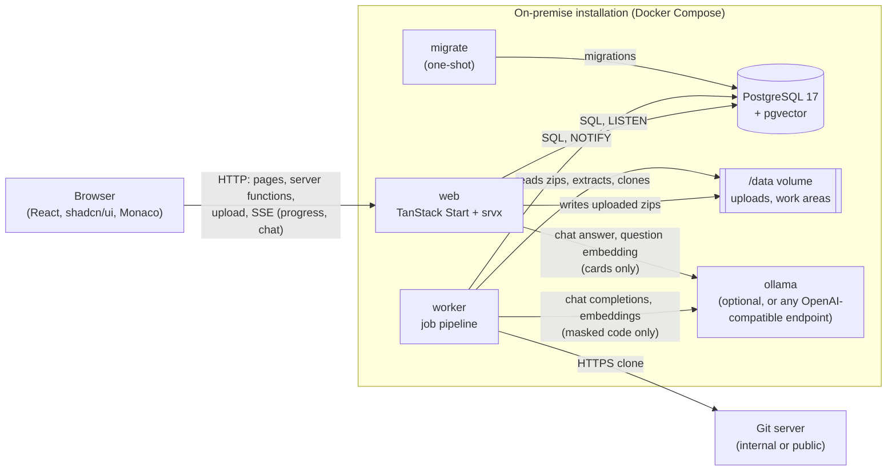
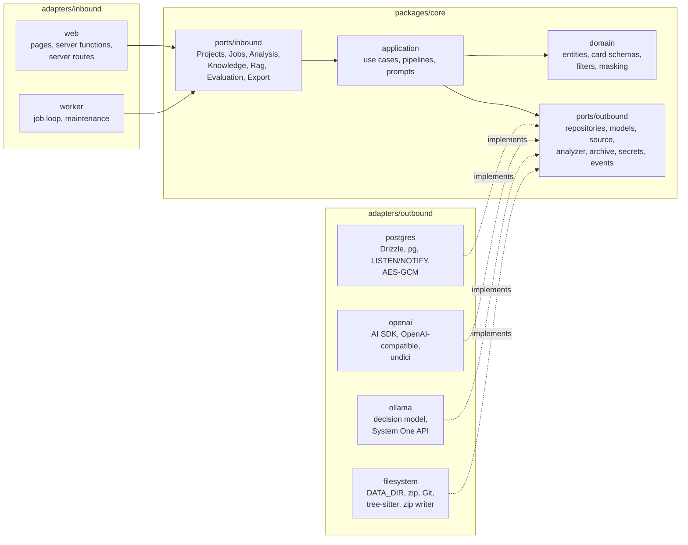

# Architecture

## Overview

Code-to-RAG consists of three processes and one database:

- **web** serves the interface, exposes the server functions (typed RPCs used by the pages) and a few server
  routes: zip upload, SSE progress stream, RAG chat stream, authentication endpoints. It never runs long tasks; the
  only model calls it makes are those of the chat (embedding of the question, streamed answer).
- **worker** takes jobs from the queue in PostgreSQL and runs the pipeline phases. Several instances can run at once.
- **migrate** applies the database migrations when the stack starts, then exits; web and worker start only after it.
- **PostgreSQL** is the only persistent store: application data, file contents (already masked), job queue, events,
  sessions, chat conversations (schema `public`) and the knowledge produced by the AI understanding, its embedding
  index (pgvector) and the test questions (schema `rag`, see [Data model](data-model.md#the-rag-schema)).
- The **/data** volume is shared by web and worker: it holds uploaded zips waiting to be processed and the temporary
  work areas of the jobs. It is emptied at the end of every acquisition.

## Hexagonal architecture

The code follows the ports-and-adapters (hexagonal) architecture. The application lives in `packages/core` and
depends on nothing but Effect. Everything that talks to the outside world is an adapter:

- **inbound (driving) adapters** receive requests (HTTP, the job queue) and call the **inbound ports**: the API of
  the use cases;
- **outbound (driven) adapters** implement the **outbound ports** the use cases need: database, model endpoints,
  file system, Git, tree-sitter.

| Folder                         | Package                   | Role                                                                                                                                                                                                                                                                                                                                                                           |
| ------------------------------ | ------------------------- | ------------------------------------------------------------------------------------------------------------------------------------------------------------------------------------------------------------------------------------------------------------------------------------------------------------------------------------------------------------------------------ |
| `packages/core`                | `@code-to-rag/core`       | The hexagon. `domain/`: entities and schemas (`model.ts`, `card.ts`, `code.ts`, `features.ts`), errors, source rules (filters, languages, limits, credential masking, file preparation, repository URL). `application/`: use cases and pipelines, read-only use cases (`queries.ts`), job operations (`jobs.ts`), prompts, configuration. `ports/inbound/`, `ports/outbound/`. |
| `adapters/inbound/web`         | `@code-to-rag/web`        | Pages, server functions and server routes; they only call the inbound ports. `src/server/runtime.server.ts` composes the outbound adapters. Authentication (Better Auth) belongs to this adapter and shares the database pool.                                                                                                                                                 |
| `adapters/inbound/worker`      | `@code-to-rag/worker`     | Job loop (claim, heartbeat, run, maintenance) over `Jobs`; `src/main.ts` composes the outbound adapters; migration command.                                                                                                                                                                                                                                                    |
| `adapters/outbound/postgres`   | `@code-to-rag/postgres`   | Drizzle schema and migrations, every repository, the model call log, the job events listener (`LISTEN/NOTIFY`), the encryption of stored secrets (AES-256-GCM), test support.                                                                                                                                                                                                  |
| `adapters/outbound/openai`     | `@code-to-rag/openai`     | `LanguageModelFactoryLive`, `EmbeddingModelFactoryLive`: build a model from the configuration resolved by core, over the AI SDK with the OpenAI-compatible provider (OpenRouter, Gemini, OpenAI, Mistral, Groq, Ollama, vLLM…; undici fetch, never the Vercel AI Gateway), retries, timeout, concurrency limit.                                                                |
| `adapters/outbound/ollama`     | `@code-to-rag/ollama`     | `DecisionModelFactoryLive` over Ollama's System One API (`POST /v1/systemone`, undici fetch): yes/no questions answered with a probability, no generated text; retries, timeout, concurrency limit.                                                                                                                                                                            |
| `adapters/outbound/filesystem` | `@code-to-rag/filesystem` | Uploads and per-job work areas under `DATA_DIR` (`StorageConfig`), safe zip extraction, Git clone (isomorphic-git), tree scan, tree-sitter analysis and import resolution (`GRAMMARS_DIR`), zip writing for the export (fflate).                                                                                                                                               |

### Inbound ports

`packages/core/src/ports/inbound/`, exported by `@code-to-rag/core` as one namespace per area. They are the only way
the inbound adapters reach the application:

| Namespace    | Use cases                                                                                                                                       |
| ------------ | ----------------------------------------------------------------------------------------------------------------------------------------------- |
| `Projects`   | create, new version, delete (with name confirmation), list, get, versions, files and masked content, upload                                     |
| `Jobs`       | state and events (progress stream), retry, stop; worker loop: claim, heartbeat, run a claimed job, maintenance; pipelines (tests)               |
| `Analysis`   | re-analyze, symbols, file analysis, dependency overview                                                                                         |
| `Knowledge`  | understanding, feature map, cards, file summaries, model call statistics, configured models; review (verify, regenerate, correct, edit, status) |
| `Rag`        | chat question, retrieval, index (build, rebuild, status), conversations                                                                         |
| `Evaluation` | test questions (generate, add, edit, delete, list), test runs                                                                                   |
| `Export`     | preview and streamed export (JSONL archive, SQL script)                                                                                         |
| `Settings`   | model settings (connections, API keys, models per group of tasks, embedding, decision model) and administrators; administrators only            |

### Outbound ports

`packages/core/src/ports/outbound/`, exported by `@code-to-rag/core/outbound` (with the domain) for the adapters:

| Port                                                                                                                                                                                                                                    | Adapter                             |
| --------------------------------------------------------------------------------------------------------------------------------------------------------------------------------------------------------------------------------------- | ----------------------------------- |
| `ProjectRepository`, `SnapshotRepository`, `JobRepository`, `AnalysisRepository`, `UnderstandingRepository`, `KnowledgeRepository`, `IndexRepository`, `EvaluationRepository`, `ChatRepository`, `ExportRepository` (`repositories.ts`) | postgres (`RepositoriesLive`)       |
| `ModelCallRecorder` (`models.ts`)                                                                                                                                                                                                       | postgres (`ModelCallRecorderLive`)  |
| `JobEventsListener` (`job-events.ts`)                                                                                                                                                                                                   | postgres (`JobEventsListenerLive`)  |
| `SecretBox` (`secret-box.ts`)                                                                                                                                                                                                           | postgres (`SecretBoxLive`)          |
| `LanguageModelFactory`, `EmbeddingModelFactory` (`models.ts`); the `LanguageModel` / `EmbeddingModel` / `DecisionModel` in use are provided by core's `ModelRegistry`                                                                   | openai (`…FactoryLive`)             |
| `DecisionModelFactory` (`models.ts`)                                                                                                                                                                                                    | ollama (`DecisionModelFactoryLive`) |
| `SettingsRepository`, `UserRepository` (`repositories.ts`)                                                                                                                                                                              | postgres (`RepositoriesLive`)       |
| `UploadStore`, `SourceWorkspace` (`source.ts`)                                                                                                                                                                                          | filesystem (`FileAdaptersLive`)     |
| `CodeAnalyzer` (`code-analyzer.ts`)                                                                                                                                                                                                     | filesystem (`CodeAnalyzerLive`)     |
| `ZipArchive` (`archive.ts`)                                                                                                                                                                                                             | filesystem (`ZipArchiveLive`)       |

### Rules

- `packages/core/src` imports only `effect` and its own files: no `node:*` module, no other package. Web standards
  available in every runtime (`crypto.randomUUID`, `crypto.subtle`, `TextEncoder`, streams) are allowed.
- Inbound adapters import `@code-to-rag/core` only (domain + inbound ports). Their composition roots
  (`runtime.server.ts`, `auth.server.ts`, `main.ts`, `migrate.ts`) also import the outbound adapters to build the
  layers. Their tests may use `@code-to-rag/core/outbound` and `@code-to-rag/core/testing` to arrange and check data.
- Outbound adapters import `@code-to-rag/core/outbound` (domain + outbound ports), never another adapter.
- Security rules belong to the hexagon: credential masking runs in core (`prepareFile`) on the bytes the
  `SourceWorkspace` adapter reads, before anything is stored.
- The rules are enforced by ESLint (`no-restricted-imports` in `eslint.config.js`): a forbidden import fails
  `pnpm lint`.
- Swapping an outbound adapter (another database, an object storage, another model provider) means writing a new
  `Layer` for the same port and composing it; adding an entry point (a public API, a CLI) means writing a new inbound
  adapter over the same inbound ports. Core and its tests do not change.

## Technologies

| Area            | Choice                                                                                            |
| --------------- | ------------------------------------------------------------------------------------------------- |
| Language        | TypeScript 6.0 strict (`exactOptionalPropertyTypes`, `noUncheckedIndexedAccess`)                  |
| Web             | TanStack Start 1.x (React 19, Vite 8), TanStack Query, srvx as the Node server in production      |
| Interface       | shadcn/ui + Tailwind CSS 4, components in the repository; `next-themes` for theming; local Monaco |
| Domain          | Effect 4 (stable APIs only): `Context.Service` + `Layer` services, `Schema.TaggedError` errors    |
| Validation      | Effect Schema for server function inputs, database rows, events                                   |
| Database        | PostgreSQL 17 + pgvector, Drizzle ORM 0.45 + `pg`, versioned migrations with drizzle-kit          |
| Authentication  | Better Auth (email and password), sharing the database pool                                       |
| Acquisition     | fflate (zip reading and writing), isomorphic-git (clone, no git binary in the images)             |
| Static analysis | web-tree-sitter (WebAssembly) with the official grammars of each language, no native modules      |
| AI              | Vercel AI SDK 7 (`ai`) + `@ai-sdk/openai-compatible`; no Vercel AI Gateway; undici for model HTTP |
| Decision model  | Ollama System One API (`/v1/systemone`), `d1-omni` by Liquid AI: probabilities, no generated text |
| RAG             | pgvector (exact cosine search) + PostgreSQL full-text search, fused with Reciprocal Rank Fusion   |
| Export          | fflate (streamed zip of JSONL files); SQL script with the DDL read from the PostgreSQL catalog    |
| Tests           | Vitest (unit, and integration on a real PostgreSQL)                                               |
| Distribution    | Multi-stage Docker: images with JavaScript bundles only, no `node_modules`                        |

### Running effects

- **Web**: a single `ManagedRuntime` (`adapters/inbound/web/src/server/runtime.server.ts`), built once per process with
  configuration, encryption, database, repositories, the event listener and the chat and embedding models. Server functions run Effect programs
  through `runEffect`, which turns expected errors into HTTP responses (404, 400, 413) and logs the others without
  exposing them to the client.
- **Worker**: the main program runs in a fiber; `SIGTERM`/`SIGINT` interrupt it and running jobs are returned to the
  queue.

## Decisions

| Decision                                                  | Rationale                                                                                                                                                                                                                                                                                                                                                                                                                                              |
| --------------------------------------------------------- | ------------------------------------------------------------------------------------------------------------------------------------------------------------------------------------------------------------------------------------------------------------------------------------------------------------------------------------------------------------------------------------------------------------------------------------------------------ |
| Hexagonal architecture, inbound and outbound apart        | Product owner's choice: core depends on Effect only; web and worker call inbound ports; database, models, file system, Git and tree-sitter are replaceable outbound adapters.                                                                                                                                                                                                                                                                          |
| Drizzle instead of `@effect/sql-pg`                       | In Effect 4.0.5 the SQL modules, drivers and platform integrations are marked unstable; only stable APIs are used.                                                                                                                                                                                                                                                                                                                                     |
| Job queue in PostgreSQL (`FOR UPDATE SKIP LOCKED`)        | No extra infrastructure on premise; consistent transactions between job state and events.                                                                                                                                                                                                                                                                                                                                                              |
| File contents in PostgreSQL (`source_blob`, deduplicated) | A single store to back up; versions share unchanged files and are compared by hash; no source files on disk after acquisition.                                                                                                                                                                                                                                                                                                                         |
| `LISTEN/NOTIFY` for progress                              | Real-time updates without a broker; the events table remains the source of truth.                                                                                                                                                                                                                                                                                                                                                                      |
| isomorphic-git                                            | No (GPL) git binary in the images; the token only goes through the authentication callback.                                                                                                                                                                                                                                                                                                                                                            |
| Full bundles for web and worker                           | Small images, exact license check on what is distributed.                                                                                                                                                                                                                                                                                                                                                                                              |
| srvx as the production server                             | Nitro 3 is still in beta.                                                                                                                                                                                                                                                                                                                                                                                                                              |
| Better Auth                                               | Product owner's choice; telemetry disabled.                                                                                                                                                                                                                                                                                                                                                                                                            |
| tree-sitter via WebAssembly                               | Same build everywhere (no native compilation); grammars ship as `.wasm` assets in the worker image (`GRAMMARS_DIR`).                                                                                                                                                                                                                                                                                                                                   |
| Native dependency targets (file, directory, namespace)    | Go packages, Java wildcard imports and C# namespaces do not map to a single file; nothing is invented.                                                                                                                                                                                                                                                                                                                                                 |
| Analysis as a separate job                                | Can be re-run on its own (new analyzer version) without re-acquiring the code.                                                                                                                                                                                                                                                                                                                                                                         |
| AI knowledge in a separate `rag` schema, no foreign keys  | Product owner's choice: the knowledge base can be read, exported or moved on its own; the application deletes it explicitly.                                                                                                                                                                                                                                                                                                                           |
| Summaries and cards in English                            | Product owner's choice; prompts are in English too.                                                                                                                                                                                                                                                                                                                                                                                                    |
| Understanding started manually, as its own job            | It costs model time: the user decides when; it can be re-run without re-acquiring or re-analyzing.                                                                                                                                                                                                                                                                                                                                                     |
| Own validation and correction loop around the AI SDK      | Effect Schema validates the answer; one correction request, then a typed error; every HTTP call is logged.                                                                                                                                                                                                                                                                                                                                             |
| Verification automatic and on demand                      | Every card is checked against the code before anyone reviews it; a reviewer can re-check after a change.                                                                                                                                                                                                                                                                                                                                               |
| Card operations as jobs (`card`, one per card)            | Model calls take minutes on modest hardware; the page polls the job and refreshes the card.                                                                                                                                                                                                                                                                                                                                                            |
| Corrections tied to the feature name                      | Product owner's choice: they survive regenerations and new feature maps; unmatched ones stay visible as orphans.                                                                                                                                                                                                                                                                                                                                       |
| Project deletion refused while a job runs                 | Avoids a worker writing to a deleted project; queued jobs are deleted with it.                                                                                                                                                                                                                                                                                                                                                                         |
| Interface in Italian; code, docs and logs in English      | Italian end users; code, documentation and logs are for developers and operators.                                                                                                                                                                                                                                                                                                                                                                      |
| Index of all cards but the excluded ones                  | Product owner's choice: the chat is usable during the review; each source shows its review state; "approved only" filter.                                                                                                                                                                                                                                                                                                                              |
| Chat in the web process, streamed (SSE)                   | Product owner's choice: answers appear while they are written; conversations are stored per user.                                                                                                                                                                                                                                                                                                                                                      |
| Multilingual embeddings + hybrid search                   | Product owner's choice: cards are in English, questions may be in Italian; full-text finds exact names, codes and messages.                                                                                                                                                                                                                                                                                                                            |
| Exact vector search, no ANN index                         | A project has hundreds to a few thousand chunks: a filtered sequential scan is fast and exact, and any dimension works.                                                                                                                                                                                                                                                                                                                                |
| Test questions generated and manual, judged by the model  | Product owner's choice: retrieval measured (hit, rank, MRR), answers judged against the expected card.                                                                                                                                                                                                                                                                                                                                                 |
| undici `fetch` for model calls                            | Node's fetch gives up after 5 minutes without response headers; models on CPU can take longer to start answering.                                                                                                                                                                                                                                                                                                                                      |
| New versions started manually, updated automatically      | Product owner's choice: "Nuova versione" acquires the code; the update of summaries and cards follows on its own.                                                                                                                                                                                                                                                                                                                                      |
| Incremental update as an `understanding` job with a base  | Same phases as a full understanding: unchanged summaries and cards are copied, only what changed goes to the model.                                                                                                                                                                                                                                                                                                                                    |
| Incremental feature map                                   | Product owner's choice: features stay (with their cards, corrections and questions); new and changed files are assigned.                                                                                                                                                                                                                                                                                                                               |
| Changed cards rewritten from the previous one             | Product owner's choice: reviewed cards return to `needs_recheck`; unchanged cards keep their review, verification, index.                                                                                                                                                                                                                                                                                                                              |
| Version in use (`project.current_snapshot_id`)            | Chat, tests and review keep working on the previous version until the update is complete; then it is replaced.                                                                                                                                                                                                                                                                                                                                         |
| Last N versions kept (`SNAPSHOT_RETENTION`)               | Product owner's choice: older versions are deleted when a new one becomes current; corrections and test questions stay.                                                                                                                                                                                                                                                                                                                                |
| Export only, no import                                    | Product owner's choice: the knowledge goes to other systems (RAG pipelines, another Postgres), not to another instance.                                                                                                                                                                                                                                                                                                                                |
| Export with embeddings, all cards or approved ones only   | Product owner's choice: the target can search at once (same embedding model); the scope is chosen at every export.                                                                                                                                                                                                                                                                                                                                     |
| SQL export with the same `rag` schema                     | Product owner's choice: the DDL is read from the database catalog, so it always matches the migrations; the script can be re-run.                                                                                                                                                                                                                                                                                                                      |
| Card verification by a decision model (`d1-omni`)         | Product owner's choice, to cut the time of the analysis: probabilities instead of generated verdicts (seconds per card instead of minutes); the decision model is required. Statements are asked about their cited lines only, since Ollama reads the state again for every question. Missing items stay with the language model (user's choice): the decision model cannot list them and answered at random when asked whether something was missing. |
| Technical features get no card (`classify-features`)      | Product owner's choice, to cut analysis time: the decision model asks whether the user documentation would describe each feature; below the threshold no card is written. The features stay in the map and a reviewer can generate their card.                                                                                                                                                                                                         |
| Files with no behaviour summarized by rules               | Product owner's choice, to cut analysis time: barrels, imports-only files and TypeScript type definitions get a summary from fixed rules (no model, exact matches only); a decision model cannot write summaries, so it is not used here.                                                                                                                                                                                                              |
| Model settings page, per group of tasks                   | Product owner's choices: administrators (first account, then granted ones) set OpenAI-compatible connections (OpenRouter, Gemini…) with sealed API keys and a model for summaries, cards and chat, plus embedding and decision model; the environment only gives the initial values. Core resolves the settings (`ModelRegistry`, cached, re-checked every 5 s), adapters only build models.                                                           |
| Export as a direct, streamed download                     | Product owner's choice: no job and no file on the server; pages are read from one read-only transaction at the client's pace.                                                                                                                                                                                                                                                                                                                          |

## Ready for durable workflows

Job phases follow the contract of Effect durable workflow activities: stable name, a single input (the job),
idempotency, output persisted before returning. A future migration will replace the pipeline engine
(`packages/core/src/application/pipeline.ts`) without rewriting the phases. See [Flows](flows.md#jobs-and-phases).
