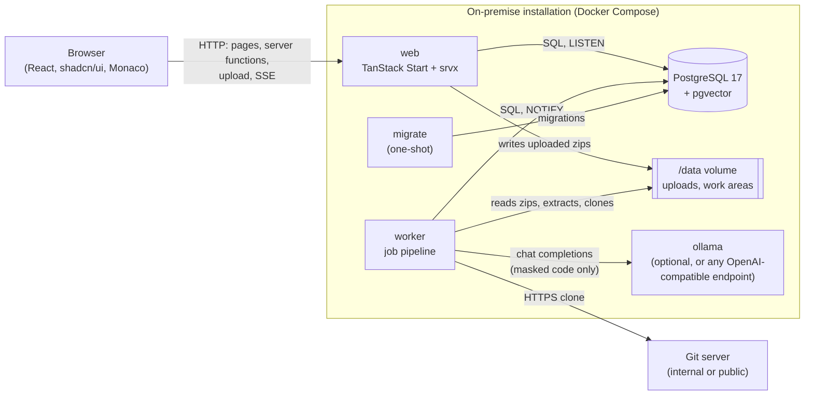
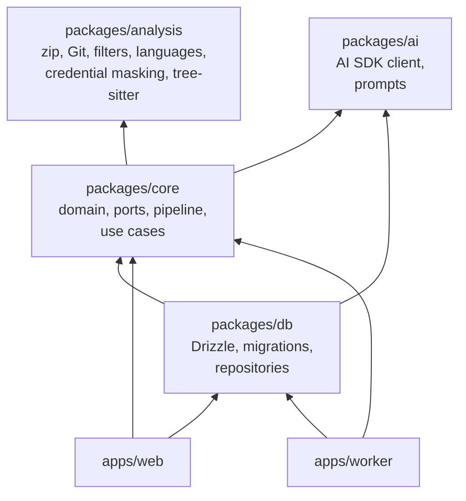

# Architecture

## Overview

Code-to-RAG consists of three processes and one database:

- **web** serves the interface, exposes the server functions (typed RPCs used by the pages) and a few server
  routes: zip upload, SSE progress stream, authentication endpoints. It never runs long tasks.
- **worker** takes jobs from the queue in PostgreSQL and runs the pipeline phases. Several instances can run at once.
- **migrate** applies the database migrations when the stack starts, then exits; web and worker start only after it.
- **PostgreSQL** is the only persistent store: application data, file contents (already masked), job queue, events,
  sessions (schema `public`) and the knowledge produced by the AI understanding (schema `rag`, see
  [Data model](data-model.md#the-rag-schema)).
- The **/data** volume is shared by web and worker: it holds uploaded zips waiting to be processed and the temporary
  work areas of the jobs. It is emptied at the end of every acquisition.

## Monorepo

pnpm workspaces, TypeScript in strict mode everywhere.

| Package             | Responsibility                                                                                                                                                                                                                                         |
| ------------------- | ------------------------------------------------------------------------------------------------------------------------------------------------------------------------------------------------------------------------------------------------------ |
| `packages/analysis` | Acquisition primitives with no application state: safe zip reading, Git clone, file classification, language detection, credential masking, tree scanning; tree-sitter parsing (symbols, imports) and import resolution.                               |
| `packages/core`     | Domain: Effect schemas (entities, inputs), typed errors, configuration, secret encryption, repository **ports**, pipeline engine, acquisition and analysis pipelines, use cases.                                                                       |
| `packages/db`       | Implementation of the ports with Drizzle and `pg`, schema and migrations, `LISTEN/NOTIFY` listener, test support.                                                                                                                                      |
| `packages/ai`       | AI layer: `LanguageModel` service over the AI SDK (OpenAI-compatible provider) with retry, timeout, concurrency limit, schema validation and one correction request; `AiConfig`; `ModelCallRecorder` port; versioned prompts and their output schemas. |
| `apps/web`          | Interface and HTTP API.                                                                                                                                                                                                                                |
| `apps/worker`       | Job process and migration command.                                                                                                                                                                                                                     |

### Ports and adapters

`core` does not know the database: it defines the repository interfaces (`ProjectRepository`, `SnapshotRepository`,
`JobRepository`, `AnalysisRepository`, `UnderstandingRepository`, `KnowledgeRepository` in `packages/core/src/ports.ts`; `ModelCallRecorder` in `packages/ai`) as Effect services. `db` implements them as `Layer`s. The
applications compose the layers at startup. The domain and the pipeline therefore stay testable and independent of
the persistence technology, and the dependency always goes from `db` to `core`, never the other way round.

## Technologies

| Area            | Choice                                                                                            |
| --------------- | ------------------------------------------------------------------------------------------------- |
| Language        | TypeScript 6.0 strict (`exactOptionalPropertyTypes`, `noUncheckedIndexedAccess`)                  |
| Web             | TanStack Start 1.x (React 19, Vite 8), TanStack Query, srvx as the Node server in production      |
| Interface       | shadcn/ui + Tailwind CSS 4, components in the repository; `next-themes` for theming; local Monaco |
| Domain          | Effect 4 (stable APIs only): `Context.Service` + `Layer` services, `Schema.TaggedError` errors    |
| Validation      | Effect Schema for server function inputs, database rows, events                                   |
| Database        | PostgreSQL 17 + pgvector, Drizzle ORM 0.45 + `pg`, versioned migrations with drizzle-kit          |
| Authentication  | Better Auth (email and password), sharing the database pool                                       |
| Acquisition     | fflate (decompression), isomorphic-git (clone, no git binary in the images)                       |
| Static analysis | web-tree-sitter (WebAssembly) with the official grammars of each language, no native modules      |
| AI              | Vercel AI SDK 7 (`ai`) + `@ai-sdk/openai-compatible`; no Vercel AI Gateway                        |
| Tests           | Vitest (unit, and integration on a real PostgreSQL)                                               |
| Distribution    | Multi-stage Docker: images with JavaScript bundles only, no `node_modules`                        |

### Running effects

- **Web**: a single `ManagedRuntime` (`apps/web/src/server/runtime.server.ts`), built once per process with
  configuration, encryption, database, repositories and the event listener. Server functions run Effect programs
  through `runEffect`, which turns expected errors into HTTP responses (404, 400, 413) and logs the others without
  exposing them to the client.
- **Worker**: the main program runs in a fiber; `SIGTERM`/`SIGINT` interrupt it and running jobs are returned to the
  queue.

## Decisions

| Decision                                                  | Rationale                                                                                                                    |
| --------------------------------------------------------- | ---------------------------------------------------------------------------------------------------------------------------- |
| Drizzle instead of `@effect/sql-pg`                       | In Effect 4.0.5 the SQL modules, drivers and platform integrations are marked unstable; only stable APIs are used.           |
| Job queue in PostgreSQL (`FOR UPDATE SKIP LOCKED`)        | No extra infrastructure on premise; consistent transactions between job state and events.                                    |
| File contents in PostgreSQL (`source_blob`, deduplicated) | A single store to back up; groundwork for incremental updates; no source files on disk after acquisition.                    |
| `LISTEN/NOTIFY` for progress                              | Real-time updates without a broker; the events table remains the source of truth.                                            |
| isomorphic-git                                            | No (GPL) git binary in the images; the token only goes through the authentication callback.                                  |
| Full bundles for web and worker                           | Small images, exact license check on what is distributed.                                                                    |
| srvx as the production server                             | Nitro 3 is still in beta.                                                                                                    |
| Better Auth                                               | Product owner's choice; telemetry disabled.                                                                                  |
| tree-sitter via WebAssembly                               | Same build everywhere (no native compilation); grammars ship as `.wasm` assets in the worker image (`GRAMMARS_DIR`).         |
| Native dependency targets (file, directory, namespace)    | Go packages, Java wildcard imports and C# namespaces do not map to a single file; nothing is invented.                       |
| Analysis as a separate job                                | Can be re-run on its own (new analyzer version) without re-acquiring the code.                                               |
| AI knowledge in a separate `rag` schema, no foreign keys  | Product owner's choice: the knowledge base can be read, exported or moved on its own; the application deletes it explicitly. |
| Summaries and cards in English                            | Product owner's choice; prompts are in English too.                                                                          |
| Understanding started manually, as its own job            | It costs model time: the user decides when; it can be re-run without re-acquiring or re-analyzing.                           |
| Own validation and correction loop around the AI SDK      | Effect Schema validates the answer; one correction request, then a typed error; every HTTP call is logged.                   |
| Interface in Italian; code, docs and logs in English      | Italian end users; code, documentation and logs are for developers and operators.                                            |

## Ready for durable workflows

Job phases follow the contract of Effect durable workflow activities: stable name, a single input (the job),
idempotency, output persisted before returning. A future migration will replace the pipeline engine
(`packages/core/src/pipeline.ts`) without rewriting the phases. See [Flows](flows.md#jobs-and-phases).
