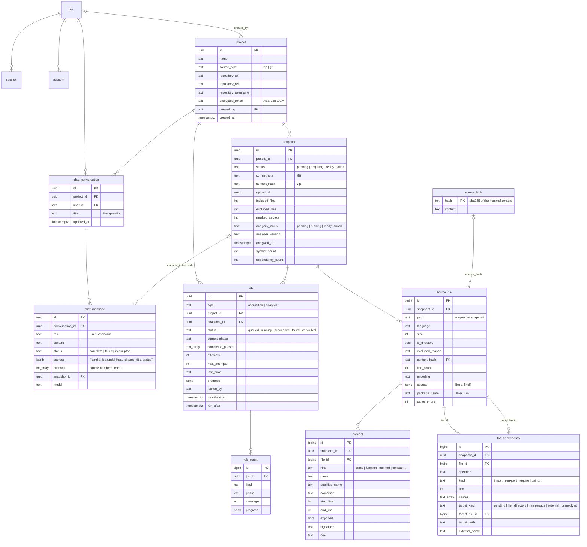
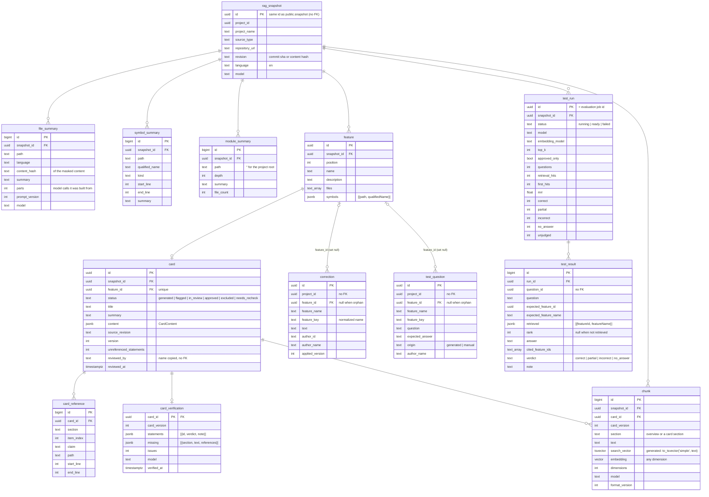

# Data model

The schema is defined with Drizzle in `packages/db/src/schema/`; versioned migrations are in
`packages/db/migrations/`. The `vector` extension (pgvector) is enabled by the first migration.

## Tables



The `user`, `session`, `account` and `verification` tables belong to Better Auth (generated with its CLI).

## Notes

- **project**: the Git token is always encrypted with `APP_ENCRYPTION_KEY` and bound to the project id (a value copied
  to another project cannot be decrypted).
- **snapshot**: an acquired version of the code. It is identified by the commit for Git and by the hash of the
  original tree (paths + content hashes) for zips.
- **source_file**: a file or an excluded directory. Excluded files only have metadata and a reason; excluded
  directories (`node_modules`, `dist`…) are a single entry with `is_directory = true`. `secrets` holds the rule and
  line of each masked credential, never the value.
- **source_blob**: masked contents, deduplicated by hash across snapshots and projects. Groundwork for incremental
  updates (phase 6).
- **snapshot (analysis columns)**: `analysis_status` is null until an analysis job is queued. `analyzer_version`
  records the version of the extraction rules (`ANALYZER_VERSION`), so snapshots analyzed with older rules can be
  recognised and re-analyzed. `symbol_count` and `dependency_count` are totals computed at the end of the analysis.
- **symbol**: a declaration. Lines refer to the masked content, which has the same lines as the original.
  `qualified_name` is the dotted path of the enclosing declarations (`OrderService.create`); `container` is the
  enclosing one (null at top level); `exported` follows the visibility rules of the language; `signature` is the
  declaration header without the body; `doc` the attached comment or docstring.
- **file_dependency**: an import as written (`specifier`, `line`, imported `names`) and its target, at the
  granularity native to the language: `file` (`target_file_id`), `directory` (Go package, Java `pkg.*`:
  `target_path`), `namespace` (C# `using`: `target_path`), `external` (library: `external_name`) or `unresolved`.
  It is `pending` between the `parse` and `resolve` phases.
- **job**: queue and state. Partial indexes for queued jobs (`run_after, created_at`) and running jobs
  (`heartbeat_at`).
- **job_event**: append-only log; the sequential id is used as the SSE event id.
- **job (types)**: `acquisition`, `analysis`, `understanding`, `card`, `indexing`, `questions`, `evaluation`. `payload`
  holds the input of card jobs (`{ cardId, featureId, operation }`) and test runs (`{ approvedOnly }`).
- **chat_conversation / chat_message**: chat conversations, private to their user, deleted with the project or the
  user. An assistant message keeps the cards given to the model (`sources`, copied: they stay readable after a
  regeneration) and the numbers its answer cites.

Rows read from the database are validated with the domain schemas (`packages/db/src/rows.ts`): an unexpected value
produces an explicit error instead of flowing into the domain.

### Model call log

`model_call` (schema `public`) records every HTTP call to a model: job, snapshot, phase, task (prompt id), prompt
version, provider, model, attempt (2 = correction request), outcome (`success | invalid_output | error | timeout`),
duration, input/output tokens and a short error (error name and HTTP status). Prompts and answers are never stored:
they contain code. The log survives the deletion of jobs and snapshots (references become null).

`snapshot` also tracks the AI understanding: `understanding_status` (`pending | running | ready | failed`, null until
requested), `understood_at`, `feature_count`, `card_count`.

## The `rag` schema

The knowledge produced by the AI understanding lives in its own Postgres schema, `rag`, kept apart from the
application tables. It is **self-contained**: no foreign key points to `public`. Projects, snapshots and files are
identified by copied ids, paths and revisions, so the schema can be read, exported or moved on its own. The
application deletes the knowledge of a snapshot itself (`rag.snapshot` cascades to every other `rag` table).



- **card.content** is the structured card (`CardContent` in `packages/ai/src/prompts/card.ts`): title, summary and the
  sections `behavior`, `configuration`, `parameters`, `limits`, `validationRules`, `errors`; every item carries its
  references. **card_reference** holds one row per cited range, for queries by file (phase 6).
- `unreferenced_statements` counts statements left without a valid reference; they count as verification issues.
- **card_verification**: the latest verification of a card; outdated when `card_version` < `card.version`.
- **correction**: reviewer corrections. They do not cascade from `rag.snapshot`: they belong to the project and to a
  feature name, survive new feature maps (re-attached by `feature_key`) and are deleted only with the project.
- The reviewer's name is copied into `card.reviewed_by` and `correction.author_name` (no link to the application's
  users, like the rest of `rag`).
- `prompt_version` and `model` are stored with every summary, feature and card.

- **chunk**: the embedding index of the chat. One overview chunk per card plus one per non-empty section. The vector
  column has no fixed dimension (`vector`): `model` and `dimensions` are stored with each row and a search only
  compares vectors of the configured model. Searches are exact (sequential scan of the snapshot's chunks through the
  `(snapshot_id, model)` index, no ANN index): a project has hundreds to a few thousand chunks. Chunks of an older
  card version are ignored until the card is re-indexed. `search_vector` (GIN index) serves the full-text search.
- **test_question**: like `correction`, belongs to the project and a feature name, re-attached after a new feature
  map, deleted only with the project. `model`/`prompt_version` are set for generated questions.
- **test_run / test_result**: a run of the test questions against the chat; results copy question and feature, which
  may change or disappear later. `rank` is the position of the expected card among the retrieved ones.

## Tables of the next phases

Phase 7 adds no tables: it exports the `rag` data of a project.

The `job` table also has `payload` (input of `card` jobs) and `dedupe_key` (one active job per card).

## Migrations

```bash
# after a change to packages/db/src/schema/*
pnpm db:generate     # creates packages/db/migrations/NNNN_*.sql
pnpm db:migrate      # applies the migrations (development)
```

In production they are applied by the `migrate` service of Docker Compose before web and worker start.
