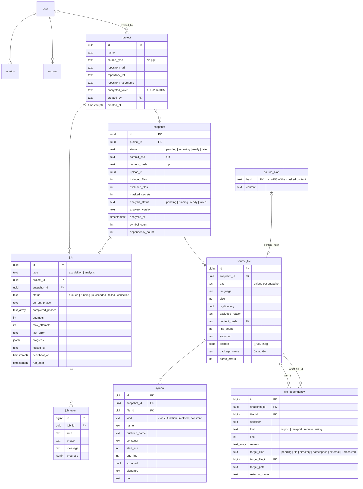

# Data model

The schema is defined with Drizzle in `packages/db/src/schema/`; versioned migrations are in
`packages/db/migrations/`. The `vector` extension (pgvector) is enabled by the first migration.

## Tables



The `user`, `session`, `account` and `verification` tables belong to Better Auth (generated with its CLI).

## Notes

- **project**: the Git token is always encrypted with `APP_ENCRYPTION_KEY` and bound to the project id (a value copied
  to another project cannot be decrypted).
- **snapshot**: an acquired version of the code. It is identified by the commit for Git and by the hash of the
  original tree (paths + content hashes) for zips.
- **source_file**: a file or an excluded directory. Excluded files only have metadata and a reason; excluded
  directories (`node_modules`, `dist`…) are a single entry with `is_directory = true`. `secrets` holds the rule and
  line of each masked credential, never the value.
- **source_blob**: masked contents, deduplicated by hash across snapshots and projects. Groundwork for incremental
  updates (phase 6).
- **snapshot (analysis columns)**: `analysis_status` is null until an analysis job is queued. `analyzer_version`
  records the version of the extraction rules (`ANALYZER_VERSION`), so snapshots analyzed with older rules can be
  recognised and re-analyzed. `symbol_count` and `dependency_count` are totals computed at the end of the analysis.
- **symbol**: a declaration. Lines refer to the masked content, which has the same lines as the original.
  `qualified_name` is the dotted path of the enclosing declarations (`OrderService.create`); `container` is the
  enclosing one (null at top level); `exported` follows the visibility rules of the language; `signature` is the
  declaration header without the body; `doc` the attached comment or docstring.
- **file_dependency**: an import as written (`specifier`, `line`, imported `names`) and its target, at the
  granularity native to the language: `file` (`target_file_id`), `directory` (Go package, Java `pkg.*`:
  `target_path`), `namespace` (C# `using`: `target_path`), `external` (library: `external_name`) or `unresolved`.
  It is `pending` between the `parse` and `resolve` phases.
- **job**: queue and state. Partial indexes for queued jobs (`run_after, created_at`) and running jobs
  (`heartbeat_at`).
- **job_event**: append-only log; the sequential id is used as the SSE event id.

Rows read from the database are validated with the domain schemas (`packages/db/src/rows.ts`): an unexpected value
produces an explicit error instead of flowing into the domain.

## Tables of the next phases

They will be added with new migrations in their phases: `feature`, `card`, `card_reference` (3),
`correction` (4), `embedding`, `test_question`, `test_run` (5).

## Migrations

```bash
# after a change to packages/db/src/schema/*
pnpm db:generate     # creates packages/db/migrations/NNNN_*.sql
pnpm db:migrate      # applies the migrations (development)
```

In production they are applied by the `migrate` service of Docker Compose before web and worker start.
