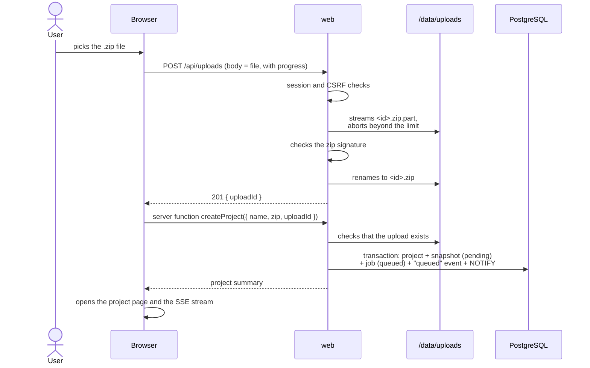
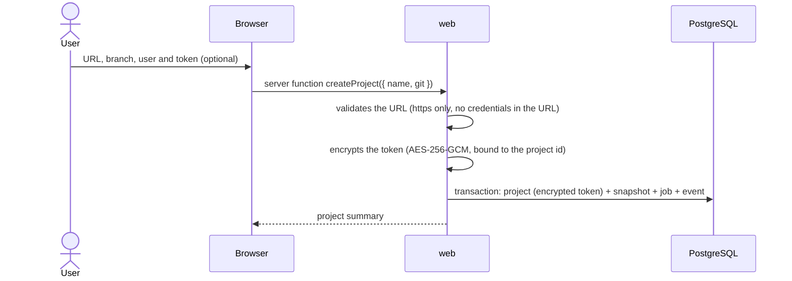
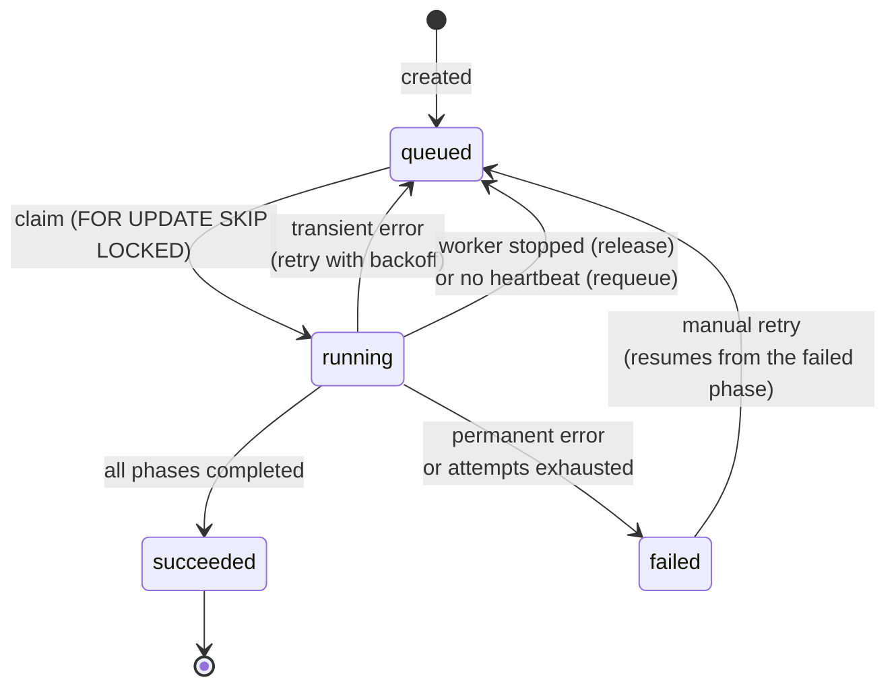
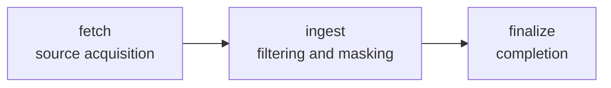
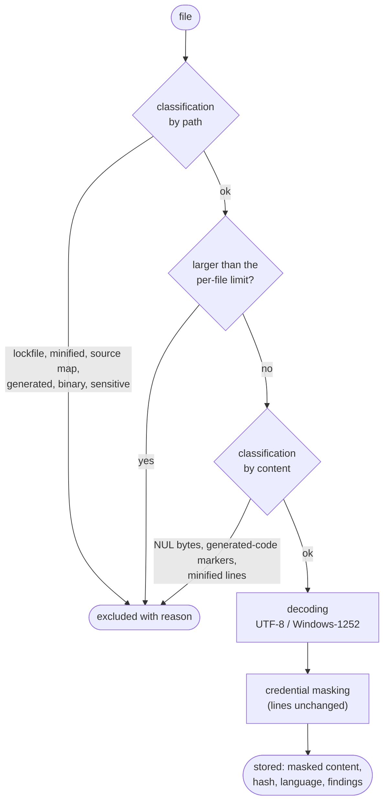
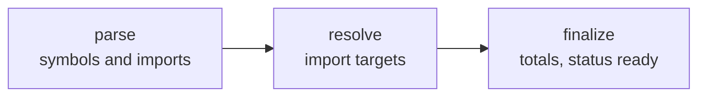
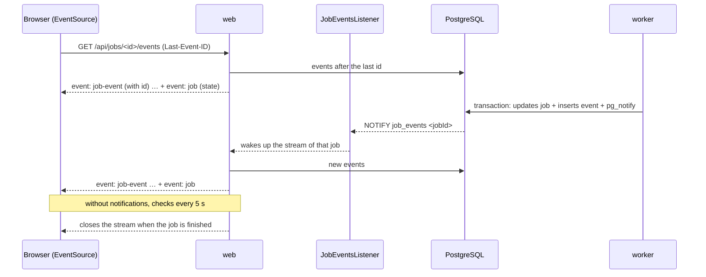
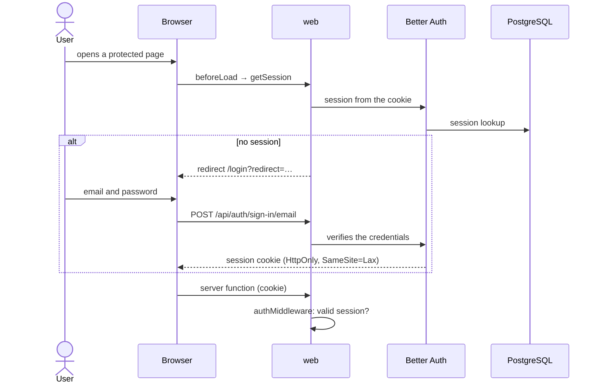

# Flows

## Creating a project from a zip archive

Upload happens in two steps: first the archive (raw request body, streamed), then the project creation with the
upload id.

An upload never attached to a project is deleted by the worker after 24 hours.

## Creating a project from a Git repository

The token is never returned to the client: the interface only knows whether the project has credentials.

## Jobs and phases

### Job lifecycle

- **Claim**: each worker takes the oldest runnable job with `UPDATE … WHERE id = (SELECT … FOR UPDATE SKIP LOCKED
LIMIT 1)`. Two workers never take the same job. The claim increments the attempt count.
- **Heartbeat**: every 15 seconds the worker updates `heartbeat_at`. A `running` job with no heartbeat for more than
  2 minutes is put back in the queue (or marked failed when it has no attempts left).
- **Errors**: each phase reports whether an error is recoverable. Corrupted archives, exceeded limits, rejected
  credentials or missing repositories fail immediately; network, database or filesystem errors are retried with
  growing delays (30 s, 60 s, 120 s… up to 15 minutes) within `JOB_MAX_ATTEMPTS`.
- **Worker shutdown**: interruption returns the job to the queue without consuming the attempt.

### Acquisition phases

Every phase is **idempotent**: it can run again and produces the same result, because it clears or overwrites
whatever a previous attempt left behind. Completed phases are recorded in `job.completed_phases`; a resumed job runs
only the missing ones.

| Phase      | What it does                                                                                                                                                                                                                                                                                                         |
| ---------- | -------------------------------------------------------------------------------------------------------------------------------------------------------------------------------------------------------------------------------------------------------------------------------------------------------------------- |
| `fetch`    | Sets the snapshot to `acquiring` and recreates the work area `/data/work/<jobId>/src`. Zip: safe extraction and recording of the skipped entries (links, encrypted entries, oversized files). Git: decrypts the token, clones the requested branch (depth 1) and stores the commit.                                  |
| `ingest`   | Re-runs `fetch` if the work area is missing (e.g. container restart). Deletes the files already stored for the snapshot, walks the tree in deterministic order, classifies, decodes (UTF-8 or Windows-1252), masks credentials and stores in batches of 200 files with progress. Computes the content hash for zips. |
| `finalize` | Snapshot `ready`, deletion of the work area and of the uploaded zip, then the static analysis is queued.                                                                                                                                                                                                             |

On a permanent failure the snapshot becomes `failed` and the work area is removed; the uploaded zip is kept so the
job can be retried manually.

### Processing a file

Dependency, build, version-control and tooling directories (`node_modules`, `dist`, `.git`, `.idea`…) are not walked:
they are recorded as a single excluded entry.

## Static analysis

An `analysis` job, separate from the acquisition, extracts declarations and imports from the masked contents stored
in PostgreSQL: it needs no work area and never reads the original code. It is queued by `requestAnalysis` at the
end of the acquisition and by the "Rianalizza" action; if one is already queued or running for the same snapshot,
that job is returned instead of creating a new one (advisory lock).

| Phase      | What it does                                                                                                                                                                                                                                                                              |
| ---------- | ----------------------------------------------------------------------------------------------------------------------------------------------------------------------------------------------------------------------------------------------------------------------------------------- |
| `parse`    | Sets `analysis_status = running`, deletes the symbols and dependencies of a previous attempt, then parses the files of the supported languages in batches of 100 with tree-sitter (WebAssembly). Stores symbols, imports (target `pending`), Java/Go package and number of syntax errors. |
| `resolve`  | Loads paths, packages and configuration files (`tsconfig*.json`, `jsconfig.json`, `package.json`, `go.mod`) of the snapshot and resolves pending imports in batches of 1000.                                                                                                              |
| `finalize` | Computes `symbol_count` and `dependency_count`, records `analyzer_version` and `analyzed_at`, sets `analysis_status = ready`.                                                                                                                                                             |

A permanent failure sets `analysis_status = failed`; the acquired snapshot stays usable.

### Extraction

For each language a tree-sitter query (`packages/analysis/src/parsing/queries.ts`) captures declarations and
imports; `extract.ts` turns the captures into symbols:

- kinds: namespace, module, class, interface, enum, struct, record, type, function, method, constructor, property,
  field, constant, variable; only top-level variables and constants are kept, not local ones;
- `qualifiedName` from the enclosing declarations (Go methods are attached to their receiver type);
- `exported` according to the language: ES `export`, `public` in Java/C#, capitalised names in Go, names without a
  leading underscore in Python;
- `signature` (declaration header without the body) and `doc` (preceding comments, Python docstring);
- syntax errors are counted, not fatal: tree-sitter recovers and the rest of the file is analyzed.
  Known gap: the TypeScript grammar (0.23.2, the latest release) does not support variance annotations
  (`<in T>`, `<out T>`); such files report errors but their declarations are still extracted.

### Import resolution

Targets keep the granularity of the language (no invented file-level edges):

| Language | Resolution                                                                                                                                                                                          |
| -------- | --------------------------------------------------------------------------------------------------------------------------------------------------------------------------------------------------- |
| TS / JS  | Relative paths with extension and `index` probing (`.js` → `.ts` too), `paths`/`baseUrl` of the nearest tsconfig/jsconfig, workspace packages by `package.json` name; bare specifiers → `external`. |
| Java     | Fully qualified classes → `file` through the declared packages; `pkg.*` → `directory`; static imports → the class file; unknown → `external`.                                                       |
| C#       | `using` → `namespace` when declared in the project, otherwise `external`.                                                                                                                           |
| Go       | Module path from `go.mod` → package `directory`; other paths → `external`.                                                                                                                          |
| Python   | Relative imports from the file's package; absolute imports from the project roots (`module.py`, `module/__init__.py`); otherwise `external`.                                                        |

## Real-time progress

- A single connection per web process runs `LISTEN job_events` and fans notifications out to the clients. If the
  connection drops it is re-established; in the meantime streams re-check the database every 5 seconds.
- Each event has a sequential id: a reconnecting `EventSource` resumes from `Last-Event-ID` without losing or
  duplicating events.
- The browser closes the stream when the job is finished; after a manual retry it opens a new one.

## Authentication

- On a fresh installation the login page offers to create the first account (administrator). After that, sign-up
  is only allowed with `AUTH_ALLOW_SIGNUP=true`.
- The check in the routes (`beforeLoad`) is for the user experience; data protection lives in `authMiddleware`,
  applied to every server function, and in the session checks of the server routes.

## Periodic maintenance (worker)

Every minute the worker:

1. puts back in the queue the jobs without a heartbeat (or marks them failed when they have no attempts left);
2. deletes zips uploaded more than 24 hours ago that are not attached to a snapshot still to be acquired.
