# Flows

## Creating a project from a zip archive

Upload happens in two steps: first the archive (raw request body, streamed), then the project creation with the
upload id.

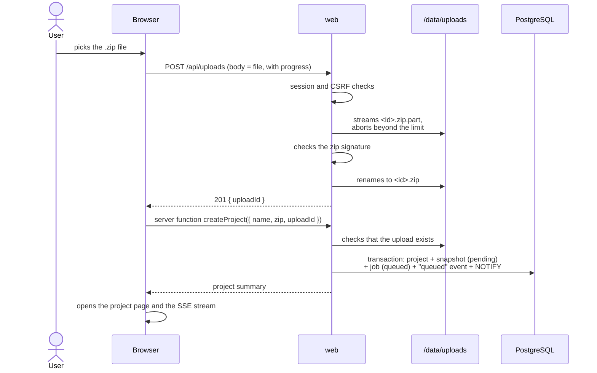

An upload never attached to a project is deleted by the worker after 24 hours.

## Creating a project from a Git repository

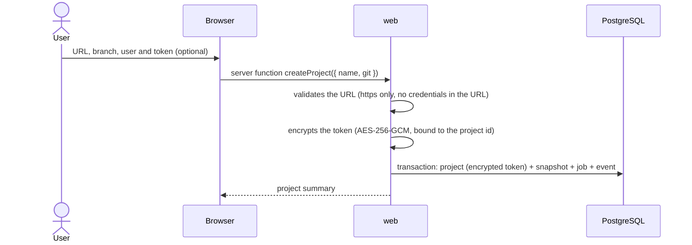

The token is never returned to the client: the interface only knows whether the project has credentials.

## Jobs and phases

### Job lifecycle

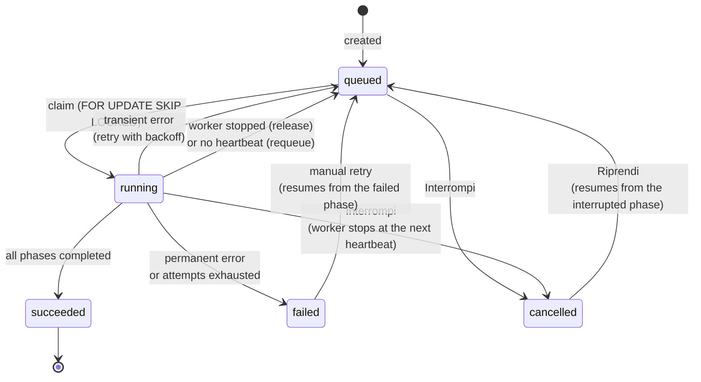

- **Claim**: each worker takes the oldest runnable job with `UPDATE … WHERE id = (SELECT … FOR UPDATE SKIP LOCKED
LIMIT 1)`. Two workers never take the same job. The claim increments the attempt count.
- **Heartbeat**: every 15 seconds the worker updates `heartbeat_at`. A `running` job with no heartbeat for more than
  2 minutes is put back in the queue (or marked failed when it has no attempts left) by the maintenance of the
  **other** workers: a worker never requeues its own jobs (its process is alive). Failed heartbeats are logged.
- **Fencing**: a run holds the job through its attempt number. The heartbeat, success, failure, retry and release of
  a run apply only while the job is still `running` with that attempt. When the heartbeat finds the job taken away
  (cancelled, or requeued and claimed again), the run is interrupted: two runs of the same job never go on together,
  and a late run cannot overwrite the state of the current one.
- **Interrompi** (progress card): a queued job is cancelled at once; a running one is marked `cancelled` and its
  worker stops it within a heartbeat (the model call in progress is abandoned). What the job was producing is marked
  failed (snapshot for the acquisition, analysis, understanding, test run); data already saved stays. **Riprendi**
  queues it again from the interrupted phase.
- **Errors**: each phase reports whether an error is recoverable. Corrupted archives, exceeded limits, rejected
  credentials or missing repositories fail immediately; network, database or filesystem errors are retried with
  growing delays (30 s, 60 s, 120 s… up to 15 minutes) within `JOB_MAX_ATTEMPTS`.
- **Worker shutdown**: interruption returns the job to the queue without consuming the attempt.

### Acquisition phases

Every phase is **idempotent**: it can run again and produces the same result, because it clears or overwrites
whatever a previous attempt left behind. Completed phases are recorded in `job.completed_phases`; a resumed job runs
only the missing ones.

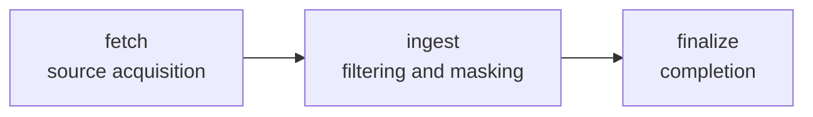

| Phase      | What it does                                                                                                                                                                                                                                                                                                         |
| ---------- | -------------------------------------------------------------------------------------------------------------------------------------------------------------------------------------------------------------------------------------------------------------------------------------------------------------------- |
| `fetch`    | Sets the snapshot to `acquiring` and recreates the work area `/data/work/<jobId>/src`. Zip: safe extraction and recording of the skipped entries (links, encrypted entries, oversized files). Git: decrypts the token, clones the requested branch (depth 1) and stores the commit.                                  |
| `ingest`   | Re-runs `fetch` if the work area is missing (e.g. container restart). Deletes the files already stored for the snapshot, walks the tree in deterministic order, classifies, decodes (UTF-8 or Windows-1252), masks credentials and stores in batches of 200 files with progress. Computes the content hash for zips. |
| `finalize` | Snapshot `ready`, deletion of the work area and of the uploaded zip, then the static analysis is queued.                                                                                                                                                                                                             |

On a permanent failure the snapshot becomes `failed` and the work area is removed; the uploaded zip is kept so the
job can be retried manually.

### Processing a file

Dependency, build, version-control and tooling directories (`node_modules`, `dist`, `.git`, `.idea`…) are not walked:
they are recorded as a single excluded entry.

## Static analysis

An `analysis` job, separate from the acquisition, extracts declarations and imports from the masked contents stored
in PostgreSQL: it needs no work area and never reads the original code. It is queued by `requestAnalysis` at the
end of the acquisition and by the "Rianalizza" action; if one is already queued or running for the same snapshot,
that job is returned instead of creating a new one (advisory lock).

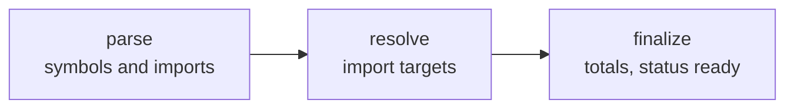

| Phase      | What it does                                                                                                                                                                                                                                                                              |
| ---------- | ----------------------------------------------------------------------------------------------------------------------------------------------------------------------------------------------------------------------------------------------------------------------------------------- |
| `parse`    | Sets `analysis_status = running`, deletes the symbols and dependencies of a previous attempt, then parses the files of the supported languages in batches of 100 with tree-sitter (WebAssembly). Stores symbols, imports (target `pending`), Java/Go package and number of syntax errors. |
| `resolve`  | Loads paths, packages and configuration files (`tsconfig*.json`, `jsconfig.json`, `package.json`, `go.mod`) of the snapshot and resolves pending imports in batches of 1000.                                                                                                              |
| `finalize` | Computes `symbol_count` and `dependency_count`, records `analyzer_version` and `analyzed_at`, sets `analysis_status = ready`.                                                                                                                                                             |

A permanent failure sets `analysis_status = failed`; the acquired snapshot stays usable.

### Extraction

For each language a tree-sitter query (`adapters/outbound/filesystem/src/parsing/queries.ts`) captures declarations and
imports; `extract.ts` turns the captures into symbols:

- kinds: namespace, module, class, interface, enum, struct, record, type, function, method, constructor, property,
  field, constant, variable; only top-level variables and constants are kept, not local ones;
- `qualifiedName` from the enclosing declarations (Go methods are attached to their receiver type);
- `exported` according to the language: ES `export`, `public` in Java/C#, capitalised names in Go, names without a
  leading underscore in Python;
- `signature` (declaration header without the body) and `doc` (preceding comments, Python docstring);
- syntax errors are counted, not fatal: tree-sitter recovers and the rest of the file is analyzed.
  Known gap: the TypeScript grammar (0.23.2, the latest release) does not support variance annotations
  (`<in T>`, `<out T>`); such files report errors but their declarations are still extracted.

### Import resolution

Targets keep the granularity of the language (no invented file-level edges):

| Language | Resolution                                                                                                                                                                                          |
| -------- | --------------------------------------------------------------------------------------------------------------------------------------------------------------------------------------------------- |
| TS / JS  | Relative paths with extension and `index` probing (`.js` → `.ts` too), `paths`/`baseUrl` of the nearest tsconfig/jsconfig, workspace packages by `package.json` name; bare specifiers → `external`. |
| Java     | Fully qualified classes → `file` through the declared packages; `pkg.*` → `directory`; static imports → the class file; unknown → `external`.                                                       |
| C#       | `using` → `namespace` when declared in the project, otherwise `external`.                                                                                                                           |
| Go       | Module path from `go.mod` → package `directory`; other paths → `external`.                                                                                                                          |
| Python   | Relative imports from the file's package; absolute imports from the project roots (`module.py`, `module/__init__.py`); otherwise `external`.                                                        |

## AI understanding

Started manually from the project page ("Genera schede", available when the static analysis is ready and `AI_MODEL`
is set): `requestUnderstanding` queues an `understanding` job (or returns the one already queued or running). It reads
only masked contents and the static analysis, and writes only to the `rag` schema.

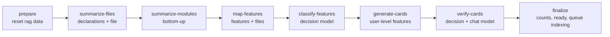

| Phase               | What it does                                                                                                                                                                                                                                                                                                                                                                                                                                                                                                                                                         |
| ------------------- | -------------------------------------------------------------------------------------------------------------------------------------------------------------------------------------------------------------------------------------------------------------------------------------------------------------------------------------------------------------------------------------------------------------------------------------------------------------------------------------------------------------------------------------------------------------------- |
| `prepare`           | Fails at once (not retried) if no model is configured. Sets `understanding_status = running`, deletes the snapshot's `rag` data and records its identity in `rag.snapshot` (project, revision, model, language).                                                                                                                                                                                                                                                                                                                                                     |
| `summarize-files`   | Application code (the analyzed languages, without tests) and configuration files (`application*.properties`, `appsettings*.json`, `config/*`…). One call per file with numbered lines and its declarations: file summary plus a sentence per relevant declaration. Files larger than the context are split at declaration boundaries and summarized in parts, then rolled up. Resumable: stored summaries are not recomputed.                                                                                                                                        |
| `summarize-modules` | Directories bottom-up, from the summaries of their files and sub-modules; pass-through directories (one child, no files) are skipped. The root module is the project overview.                                                                                                                                                                                                                                                                                                                                                                                       |
| `map-features`      | The model lists the user-level features with their files and declarations, from the module overview and one line per file. Large projects are mapped in batches, then the candidates are merged. Paths and declarations that do not exist are dropped.                                                                                                                                                                                                                                                                                                               |
| `classify-features` | The decision model (prompt `feature-triage`) answers for each feature without a card: "would the user documentation of this application describe this feature?", from its name, description and files. Below `TRIAGE_USER_FACING_THRESHOLD` (0.4) the feature is **technical** (bootstrap, build, tests, tooling): `generate-cards` writes no card for it, which saves the language model's time. In an incremental update a feature that had a card in the base keeps one. The probability and the decision are stored on the feature (`user_facing`, `technical`). |
| `generate-cards`    | For each feature, the files are read together: whole when they fit, otherwise the declarations of the feature with some context, then the first lines of the other files, then summaries only. The card cites path and lines for every statement; references outside the lines shown are dropped and statements left without one are counted. Resumable per card.                                                                                                                                                                                                    |
| `verify-cards`      | Every card against its code: decision model on the statements, chat model for missing items (see [Review](#automatic-verification)). Resumable: cards whose current version is verified are skipped.                                                                                                                                                                                                                                                                                                                                                                 |
| `finalize`          | Counts features and cards, `understanding_status = ready`, queues the indexing of the cards for the chat (when `EMBEDDING_MODEL` is set).                                                                                                                                                                                                                                                                                                                                                                                                                            |

- **Streaming**: answers are always streamed and parsed at the end. Model calls go through undici's `fetch` with no
  headers or body timeout (`adapters/outbound/openai/src/fetch.ts`): Node's built-in `fetch` gives up when the response headers
  take more than 5 minutes, which happens on CPU when the model reads a long prompt before its first token. The only
  limit is `AI_TIMEOUT`, per call.
- **Budget**: every prompt is sized from `AI_CONTEXT_TOKENS - AI_MAX_OUTPUT_TOKENS` (conservative estimate of 3
  characters per token).
- **Invalid answers**: the answer is validated with the Effect schema of the prompt; if it does not match, the model
  gets its answer back with the validation problems once; a second invalid answer skips that file, module or card
  (counted in the progress message) instead of failing the job.
- **Transient errors** (network, 408/429/5xx, timeout) are retried by the AI layer (`AI_MAX_RETRIES`, exponential
  backoff), then by the job runner from the failed phase; configuration errors (missing model, 4xx) fail at once.
- **Prompts are versioned** (`packages/core/src/application/prompts/*`): the version is stored with every result and in the call
  log. Changing a prompt means bumping its version.
- Requesting the understanding again ("Rigenera schede") starts from scratch for that snapshot. A new version of the
  code is instead updated incrementally (see [New versions](#new-versions-incremental-update)). Reviewer corrections
  are kept: after the new feature map they are re-attached to the feature with the same name and applied to its new
  card (see [Review](#review)).
- Understanding and card jobs exclude each other on a project: a new feature map would replace the cards being
  reviewed. The same holds for test question generation and test runs.

## Review

### Automatic verification

`verify-cards` (last phase of the understanding) and the "Verifica" action on a card check the card in two steps
(`packages/core/src/application/prompts/verify.ts`). Statements are identified as `section.index`.

1. **Statements, by the decision model** (`DecisionModel`, Ollama's System One API, `d1-omni` by default; questions
   `card-verify` version 3). It generates no text: every answer is the probability of "true", computed in one pass.
   - One question per statement: "according to the source code, is this statement true?". Ollama reads the state
     again for every question (the input tokens are state × questions), so a statement that cites code gets only its
     cited lines with 10 lines of context (`citedExcerpts`); statements citing the same lines share a request.
     Statements without references are asked with the card and the code of the whole feature
     (`buildCardExcerpts`, sized to `DECISION_CONTEXT_TOKENS`).
   - Verdicts by threshold: `supported` at or above `VERIFY_SUPPORTED_THRESHOLD` (0.7), `unsupported` below
     `VERIFY_UNSUPPORTED_THRESHOLD` (0.3), `partial` in between; the probability is stored with the verdict and shown
     on the review page.
2. **Missing items, by the language model** (prompt `card-missing`): it reads the card next to the code of the
   feature and lists what the code shows and the card misses (validation rules, limits, errors, settings), with the
   lines that show it; references outside the shown code are dropped. A decision model cannot write this list: asked
   only whether something was missing, `d1-omni` answered at random.

The result is stored per card version in `rag.card_verification`, with both models in `model` (e.g.
`d1-omni + code-to-rag-dev`); verifications before `card-verify` version 3 were written by the language model alone
and keep their notes:

- `issues` = statements not fully supported + missing items + statements without references;
- a card still `generated` or `flagged` becomes `flagged` when issues were found, `generated` otherwise; review
  decisions (`in_review`, `approved`, `excluded`) are not touched;
- a verification of an older version is shown as outdated; the next understanding run verifies the card again.

### Card states

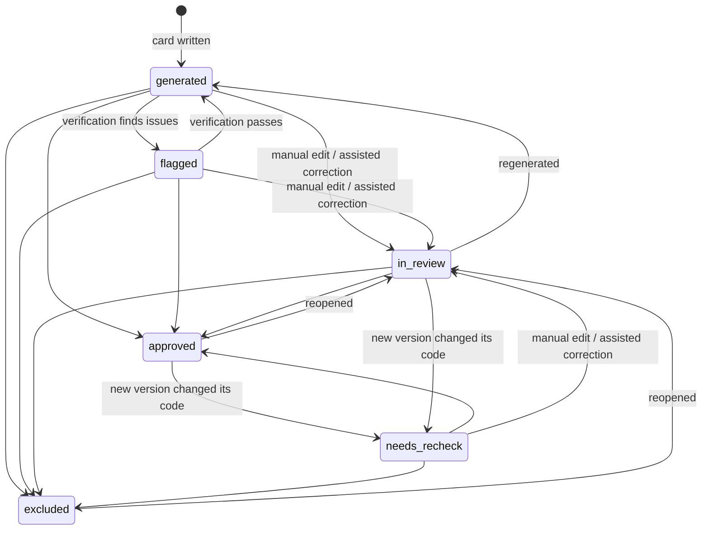

`needs_recheck` ("Da riverificare") marks a reviewed card that an incremental update rewrote for new code (or could
not rewrite: the previous card is kept): the reviewer confirms it again.

### Operations

The review page (`/projects/<id>/cards/<featureId>`) shows the card next to the code: the files of the feature as
tabs, every cited range marked, the selected statement in focus.

| Action              | How it runs                                                                                                                                                                                                                                      |
| ------------------- | ------------------------------------------------------------------------------------------------------------------------------------------------------------------------------------------------------------------------------------------------ |
| Approve / Exclude   | Immediate; the reviewer's name and time are stored on the card. Reopening puts it back `in_review`.                                                                                                                                              |
| Edit                | Structured form (every section, item and reference). References must point to existing lines of the snapshot's files, the others are dropped. New version, `in_review`; the verification becomes outdated.                                       |
| Assisted correction | The reviewer describes the mistake. The text is stored in `rag.correction`, then a `card` job asks the model to update the current card checking the code again; the new version is `in_review` and verified.                                    |
| Verify              | `card` job: verification of the current version.                                                                                                                                                                                                 |
| Generate            | Feature without a card (technical, or its card could not be written): "Genera la scheda" on the features page; the feature stops being technical and a `card` job (`generate`) writes the card with the feature's corrections, then verifies it. |
| Regenerate          | `card` job: the card is written from scratch with all the feature's corrections, then verified (`generated`/`flagged`). Manual edits are lost; corrections are not.                                                                              |

Card jobs carry `{ cardId, featureId, operation }` in `job.payload`; there is at most one active job per card
(`dedupe_key` = feature id). They look the card up by feature, since regeneration replaces the card row.

### Corrections across regenerations

Corrections belong to the project and to a feature **name** (`feature_key`: lower case, punctuation and spacing
ignored), not to a card. Every card written for that feature (understanding, regeneration, correction) gets them in
its prompt, oldest first, and records the version that applied them. After a new feature map they are re-attached by
name; those whose feature disappeared are listed as orphans in the features tab.

## Embedding index

The chat finds cards through an index in `rag.chunk`. Every card that is not excluded is split into **chunks**: an
overview (title, feature name, summary) and one chunk per non-empty section (what it does, configuration,
parameters, limits, validation rules, errors), each starting with the card title. References are not embedded.
Every chunk stores the embedding (pgvector, any dimension: the model and the dimension are stored with it) and a
full-text vector (`to_tsvector('simple', text)`, generated column with a GIN index).

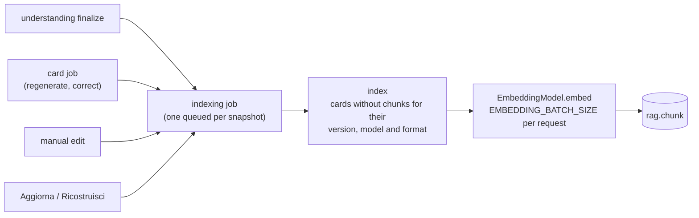

- The `indexing` job has one phase, `index`: it lists the non-excluded cards with no chunks for their current
  version, the configured model and the chunk format (`CARD_CHUNK` version), embeds their chunks eight cards at a
  time and replaces the chunks of each card in a transaction. A card edited meanwhile is skipped (its version
  changed) and picked up by the next round; the job makes up to three rounds.
- A queued indexing job absorbs new requests; a running one does not, so a change made while it runs always gets a
  new job. Concurrent jobs on the same card are serialised by an advisory lock.
- Review decisions do not re-index: the status is read at search time. Excluded cards keep their chunks but are
  never returned; reopening them makes them searchable again at once.
- Without `EMBEDDING_MODEL` no indexing job is queued. Changing model re-indexes every card (vectors of different
  models are never compared). "Ricostruisci" deletes the snapshot's chunks first.

## RAG chat

The chat page (`/projects/<id>/chat`) asks questions about the version of the project in use (whose cards are
ready; a new version answers only once its update is complete). It runs in the web process: one request per question, answered as a stream.

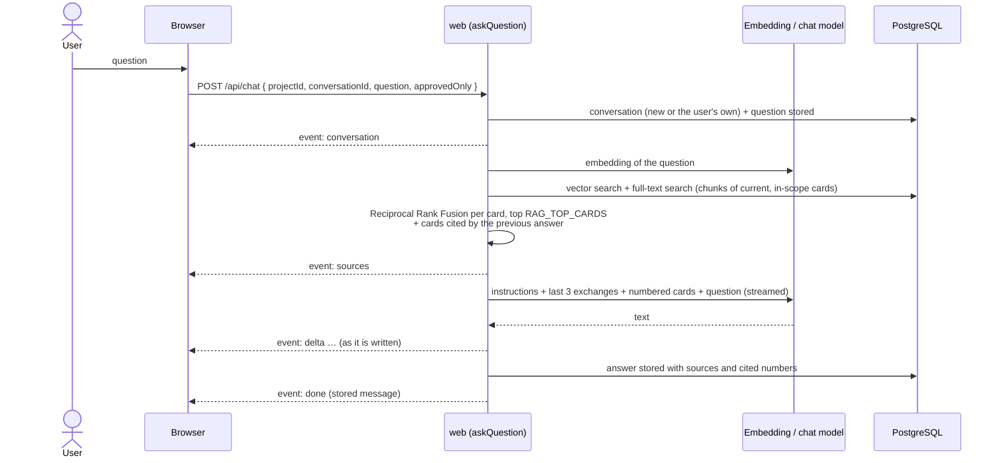

- **Retrieval**: the question is embedded with the configured model and compared by cosine distance (`<=>`, exact
  scan of the snapshot's chunks, no ANN index) with the chunks of the current version of every card in scope (not
  excluded; only approved with "Solo schede approvate"). In parallel, a full-text search looks for any word of the
  question (3+ characters, `simple` configuration: names, codes and messages match across languages). Each list
  gives each card `1 / (60 + rank of its best chunk)`; the sums rank the cards.
- **Prompt** (`chat-answer`): the best cards as plain text, numbered `[1]`, `[2]`…, sized to
  `AI_CONTEXT_TOKENS - AI_CHAT_MAX_OUTPUT_TOKENS` (the first card is shortened if it does not fit alone, the others
  are left out). The model answers in the language of the question, only from the sources, citing them by number,
  and says so when the sources do not contain the answer.
- **Citations**: numbers outside the sources are ignored. The page shows each cited card with its review state and
  opens its review page; unreferenced sources are shown dimmed.
- **Conversations** belong to the user who started them (`chat_conversation`, `chat_message`). Follow-up questions
  get the last three complete exchanges and the cards cited by the previous answer.
- **Errors and interruptions**: a model error stores the partial answer as `failed` and sends an `error` event with
  the short message; closing the page (or "Interrompi") interrupts the model call and stores the partial answer as
  `interrupted`. Every model call goes to `model_call` (phases `chat` with tasks `chat-query` and `chat-answer`).

## Test questions

The tests page (`/projects/<id>/tests`) holds questions a user could ask, each tied to the feature whose card
answers it.

- **Generation** ("Genera domande", `questions` job, phase `generate`): for every non-excluded card without generated
  questions, the `test-questions` prompt writes `TEST_QUESTIONS_PER_CARD` questions in `TEST_QUESTIONS_LANGUAGE`, with
  the expected answer. Resumable; running it again only covers new cards.
- **Manual questions**: add, edit and delete, with an optional expected answer.
- Like corrections, questions belong to the project and to the feature **name**: after a new feature map they are
  re-attached by name; the others are shown as orphans and not run.
- **Test run** ("Esegui i test", `evaluation` job, run id = job id), on the version in use. The page lists the runs
  of every kept version of the project, with their revision, so that a new version can be compared with the
  previous one:

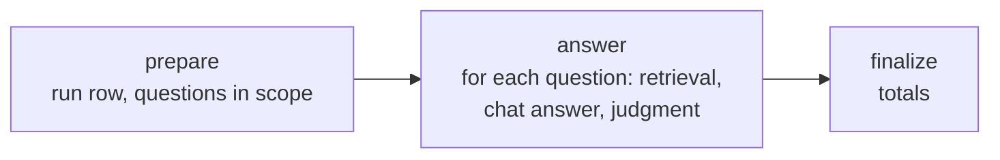

| Phase      | What it does                                                                                                                                                                                                                                                                                                                                                                              |
| ---------- | ----------------------------------------------------------------------------------------------------------------------------------------------------------------------------------------------------------------------------------------------------------------------------------------------------------------------------------------------------------------------------------------- |
| `prepare`  | Fails at once without chat or embedding model. Creates (or resets) the run with the models, `RAG_TOP_CARDS`, the "approved only" option and the number of questions whose card is in scope.                                                                                                                                                                                               |
| `answer`   | For each question not answered yet by this run: same retrieval and prompt as the chat (no history); records the rank of the expected card among the retrieved ones, the answer, the cited features; then `answer-judge` compares the answer with the expected card (and expected answer): `correct`, `partial`, `incorrect`, `no_answer`. An invalid judgment leaves the result unjudged. |
| `finalize` | Totals: questions whose card was retrieved (within `RAG_TOP_CARDS`) and ranked first, mean reciprocal rank, verdict counts. Run `ready` (`failed` when the job fails for good).                                                                                                                                                                                                           |

## New versions (incremental update)

"Nuova versione" on the project page acquires the code again: a new archive for zip projects, the latest commit of
the configured branch for Git projects. The version in use (`project.current_snapshot_id`) stays in use for pages,
chat and tests until the new one is complete.

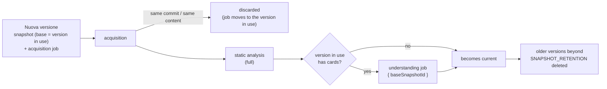

- **Start**: refused while a job of the project other than indexing is queued or running. The new snapshot records
  its base (`snapshot.base_snapshot_id`).
- **Nothing changed**: when the acquisition finds the commit (Git, checked before storing files) or the content hash
  (zip) of the base, the new snapshot is deleted and its job is moved to the version in use; the page shows "Nessuna
  modifica rispetto alla versione in uso".
- **File changes**: at the end of the static analysis the included files are compared with the base by path and hash
  of the masked content (`snapshot.changes.files`: added, modified, removed).
- **Update** (`understanding` job with `payload = { baseSnapshotId }`, same phases as a full understanding):

| Phase               | Incremental behaviour                                                                                                                                                                                                                                                                                                                                                                                                                                                                                                                             |
| ------------------- | ------------------------------------------------------------------------------------------------------------------------------------------------------------------------------------------------------------------------------------------------------------------------------------------------------------------------------------------------------------------------------------------------------------------------------------------------------------------------------------------------------------------------------------------------- |
| `prepare`           | After the reset, copies the file (and declaration) summaries of unchanged files from the base, when written by the same model and prompt version.                                                                                                                                                                                                                                                                                                                                                                                                 |
| `summarize-files`   | Summarizes only what was not copied: new and modified files.                                                                                                                                                                                                                                                                                                                                                                                                                                                                                      |
| `summarize-modules` | Copies the summary of every module whose subtree has no changed path; the modules above a change (up to the root) are summarized again.                                                                                                                                                                                                                                                                                                                                                                                                           |
| `map-features`      | `feature-update` prompt instead of `feature-map`: the features of the base are carried over without deleted files and declarations (a feature left without files is dropped); new and modified files are given to the model with the existing features, and attached to them (same name) or grouped into new features. Corrections and test questions are re-attached by name (`keepApplied`).                                                                                                                                                    |
| `generate-cards`    | Per feature, matched by name with the base: same files and content (or an excluded card) → the card is **copied** with status, version, review, verification, references and index chunks (`change = kept`); files changed → the model **updates** the previous card (with the corrections and the list of changed files), version + 1, `change = updated`, an approved or in-review card becomes `needs_recheck`; new feature → card written from scratch (`change = created`). An update that fails keeps the previous card as `needs_recheck`. |
| `verify-cards`      | Verifies only the cards without a verification of their version: the copied ones keep theirs.                                                                                                                                                                                                                                                                                                                                                                                                                                                     |
| `finalize`          | Re-attaches corrections and test questions written meanwhile, stores the card changes (`snapshot.changes.cards`: kept, updated, created, removed), makes the version current, deletes old versions, queues the indexing (copied cards already have their chunks: only updated and new ones are embedded).                                                                                                                                                                                                                                         |

- **During the update** the review of the version in use is read-only (approve, exclude, edit, correct, regenerate,
  verify, "Rigenera schede", question generation and test runs are refused): the update reads its cards and the
  changes would not reach the new version. The chat and manual test questions keep working. If the update fails, the
  version in use stays; the job can be retried, or another new version started.
- **Retention**: when a version becomes current, older versions are deleted except the newest complete ones, up to
  `SNAPSHOT_RETENTION` versions in all (default 3). Deleted with them: files, analysis, jobs, knowledge, index, test
  runs, the archives on disk and the blobs no other file uses. Corrections, test questions and conversations belong to
  the project and stay; chat messages keep their copied sources. Versions newer than the current one (a failed
  update) are kept until a later version becomes current.
- The **Versioni** tab lists the kept versions with their state (in use, previous, updating, failed) and changes.

## Knowledge export

"Esporta" on the project page (once the cards are generated) opens a dialog: format, scope and a preview of what the
file will contain (rows per table, embedding models).

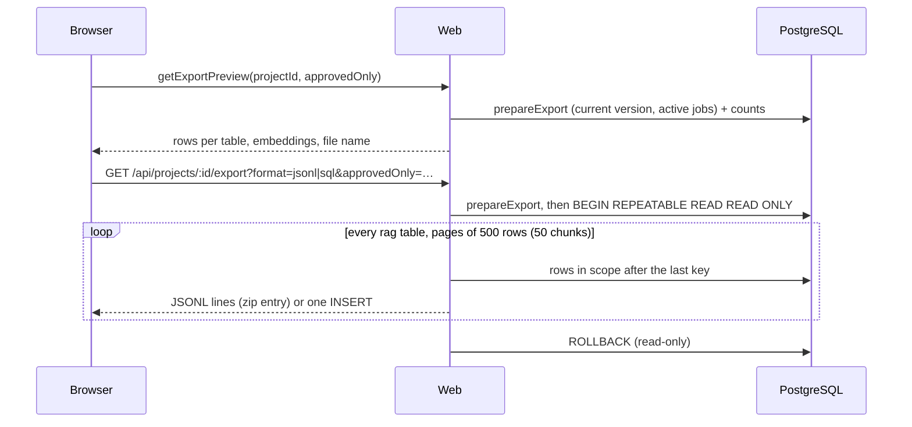

- **What**: the version in use (`project.current_snapshot_id`): `rag.snapshot`, file, symbol and module summaries,
  features, cards, references, verifications, corrections, chunks (embeddings of the current card versions), test
  questions, test runs and results. **Scope**: every card except excluded ones (with their status) or approved ones
  only; features, references, verifications, chunks, corrections and test questions follow the exported cards; with
  "approved only", only test runs over approved cards. Summaries are always exported. Serial ids and generated columns
  (`search_vector`) are left out: the target assigns or computes them.
- **Refused** (`prepareExport`) before the cards are generated and while they are being generated again (understanding
  or card jobs on the current version). During an indexing job the export is allowed, with a warning (chunks of the
  latest changes may be missing). A new version being acquired or updated does not matter: the current one does not
  change until the update is complete.
- **JSONL archive** (`<project>-<revision>-knowledge[-approved].zip`): `manifest.json` (format and version, project,
  revision, language and model of the cards, scope, embedding models with dimensions, then for every table its file,
  row count and columns with their PostgreSQL types) and `<table>.jsonl`, one JSON object per row keyed by column name
  (vectors as arrays of numbers, timestamps in UTC).
- **SQL script** (`….sql`): header comments, `BEGIN`, `CREATE EXTENSION IF NOT EXISTS vector`, `CREATE SCHEMA IF NOT
EXISTS rag`, `CREATE TABLE/INDEX IF NOT EXISTS` for every `rag` table (built from the database catalog, so it matches
  the migrations), deletion of the rows of the same project (`rag.snapshot` cascades, corrections and test questions by
  `project_id`), multi-row `INSERT`s, `COMMIT`. It can be run again (e.g. after a newer export) with the same result.
  A target with a `rag` schema of an older format keeps its tables: the manifest and the header carry the format
  version (`EXPORT_FORMAT_VERSION`).
- Both are written while they are read (`writeExport`, `core/src/application/export/`): pages from one repeatable-read, read-only
  transaction (`ExportRepository`), so the files are consistent with each other; the response stream waits for the
  client to read before reading the next page, and closing the download stops the export.

## Deleting a project

"Elimina progetto" on the project page, confirmed by typing the project name. Refused while a job of the project is
running (queued jobs are deleted with it). In order: the project's knowledge in the `rag` schema (snapshots,
summaries, features, cards, verifications, corrections; deleted explicitly since `rag` has no foreign keys), then the
project with its snapshots, files, symbols, jobs and events (cascade), the masked blobs no other project uses, and the
uploaded archives on disk. The `rag` deletion includes the embedding index, the test questions and runs; chat
conversations cascade with the project. The model call log is kept (its references become null).

## Real-time progress

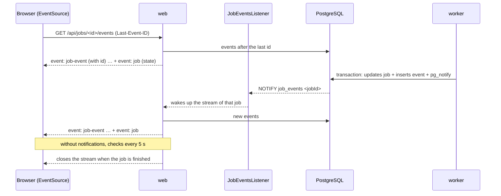

- A single connection per web process runs `LISTEN job_events` and fans notifications out to the clients. If the
  connection drops it is re-established; in the meantime streams re-check the database every 5 seconds.
- Each event has a sequential id: a reconnecting `EventSource` resumes from `Last-Event-ID` without losing or
  duplicating events.
- The browser closes the stream when the job is finished; after a manual retry it opens a new one.

## Authentication

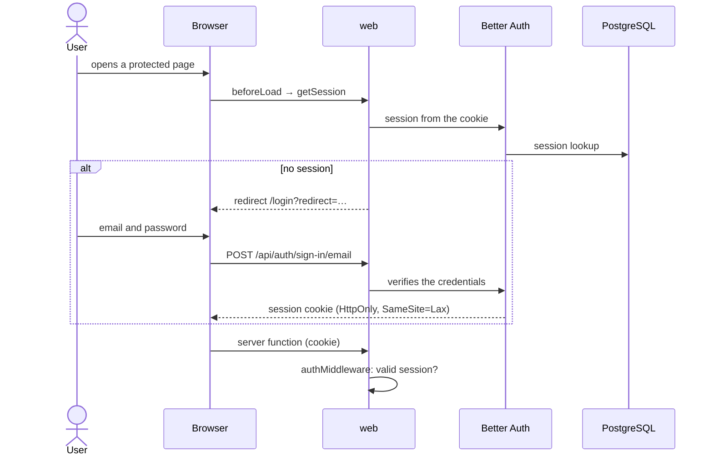

- On a fresh installation the login page offers to create the first account (administrator). After that, sign-up
  is only allowed with `AUTH_ALLOW_SIGNUP=true`.
- The check in the routes (`beforeLoad`) is for the user experience; data protection lives in `authMiddleware`,
  applied to every server function, and in the session checks of the server routes.

## Periodic maintenance (worker)

Every minute the worker:

1. puts back in the queue the jobs without a heartbeat (or marks them failed when they have no attempts left);
2. deletes zips uploaded more than 24 hours ago that are not attached to a snapshot still to be acquired.
